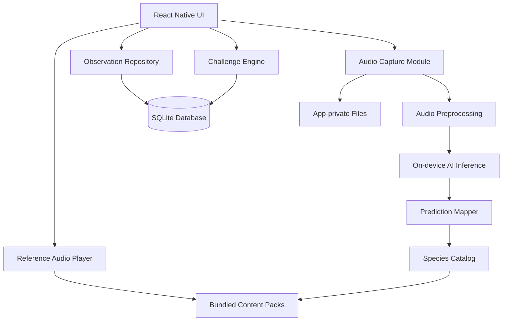
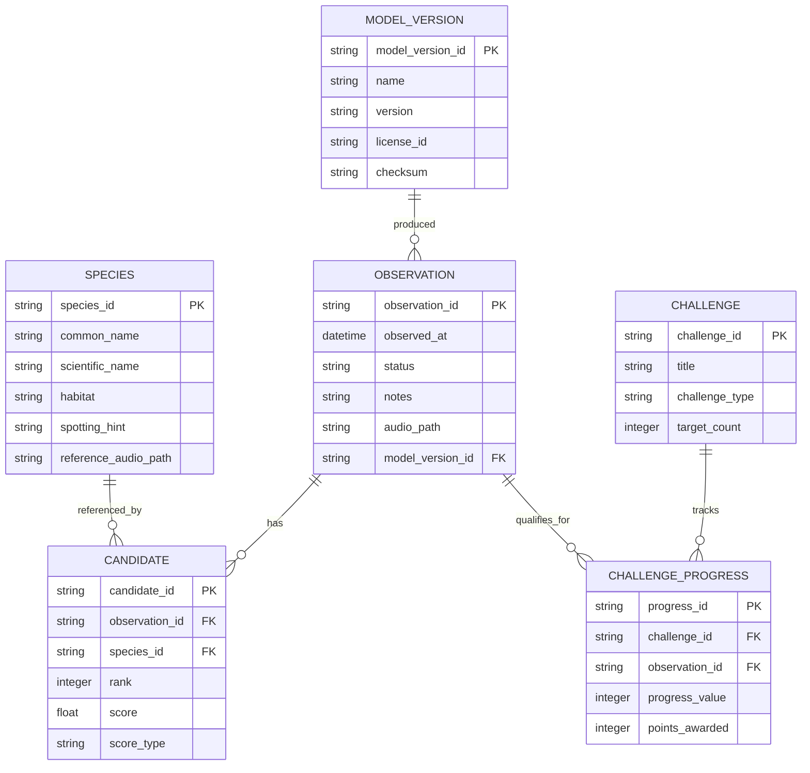

# EchoTrail — Software Requirements Specification (SRS)

**Project:** EchoTrail — The Invisible Bird Guide  
**Document version:** 1.0  
**Date:** 10 October 2026  
**Platform:** React Native + TypeScript  
**Document status:** Initial development specification

---

## 1. Introduction

### 1.1 Purpose

This Software Requirements Specification (SRS) defines the functional, technical, and quality requirements for EchoTrail, an offline-first, AI-powered bird identification and discovery application.

It is intended to guide implementation, testing, design, and project evaluation. It describes what the application must do, how its major components interact, and how the finished product will be validated.

### 1.2 Project overview

EchoTrail helps users identify birds from their calls and guides them through learning about and potentially spotting those birds. Rather than ending at a predicted species name, the application combines on-device audio classification with reference calls, practical spotting clues, an observation journal, and birdwatching challenges.

**Core user journey:**

1. **Listen:** Record 5–10 seconds of birdsong.
2. **Identify:** Run an audio classifier locally and show likely species.
3. **Compare:** Play reference calls and compare distinctive sounds.
4. **Explore:** Read habitat, behavior, and spotting clues.
5. **Discover:** Save the observation and progress through challenges.

### 1.3 Problem statement

Birdwatching beginners often hear unfamiliar bird calls but cannot identify the species or know where to look. Identification tools can provide a label, but users may still need help interpreting the result and learning how to observe the bird.

EchoTrail turns identification into an outdoor learning activity while keeping recordings private and allowing the core workflow to operate offline.

### 1.4 Objectives

- Identify likely bird species from short audio recordings.
- Run the core identification workflow without internet access.
- Provide reference calls and species-specific observation guidance.
- Maintain a private, persistent observation journal on the device.
- Encourage exploration through challenges and progress tracking.
- Support open-source development and compatible community-contributed content.

### 1.5 Definitions

| Term | Definition |
|---|---|
| SRS | Software Requirements Specification |
| On-device inference | Running an AI model locally on the device |
| Bird classifier | Model that predicts likely bird species from audio |
| Candidate species | A species suggested by the classifier |
| Reference call | A recording of a known bird call used for comparison |
| Observation | A record of hearing or spotting a bird |
| Content pack | Species information and associated media assets |
| Offline-first | Core functionality does not depend on network access |
| Model score | Numeric model output that is not necessarily a calibrated probability |

---

## 2. Scope

### 2.1 In scope for the MVP

- Android-first React Native application written in TypeScript.
- Microphone permission handling and audio recording.
- On-device bird sound classification.
- Ranked candidate species with uncertainty messaging.
- Offline species information and reference calls.
- Practical bird-spotting clues.
- Local observation history and optional saved audio.
- Basic challenges, achievements, and progress.
- Model provenance, version information, and license attribution.
- Local data deletion and privacy controls.
- Repeatable demonstration using real or preloaded bird recordings.

### 2.2 Out of scope for the MVP

- Mandatory user accounts or cloud synchronization.
- Server-side audio inference.
- Social networking and public leaderboards.
- Real-time continuous listening.
- Automated visual confirmation of a bird.
- A complete worldwide bird encyclopedia.
- Public model marketplace.
- Automatic submission of observations to external conservation platforms.
- Exact bird location claims based only on audio classification.

### 2.3 Target platforms

| Platform | Scope |
|---|---|
| Android | Primary MVP platform |
| iOS | Possible future extension after runtime and device validation |
| Web | Not targeted for the initial release because native audio and local inference are central requirements |

---

## 3. Stakeholders and user classes

### 3.1 Primary users

- Beginner birdwatchers.
- Students and nature enthusiasts.
- Hikers and outdoor explorers.
- Users learning to recognize bird calls.

### 3.2 Secondary stakeholders

- Bird researchers and nature educators.
- Open-source contributors.
- Model maintainers.
- Contributors to licensed bird audio, images, and species information.

The application should be usable by nontechnical users. Users should not need to understand machine-learning scores, sample rates, or model formats.

---

## 4. Overall system description

### 4.1 Product perspective

EchoTrail is a standalone mobile application. The MVP does not require a backend server, external API, cloud database, or user account for its primary functionality.

The React Native application coordinates audio capture, local AI inference, species information, storage, and challenges.

### 4.2 Proposed operating environment and technology stack

| Component | Proposed technology |
|---|---|
| Mobile framework | React Native |
| Language | TypeScript |
| Build tooling | Expo development build or React Native Community CLI |
| Initial platform | Android |
| AI inference | ONNX Runtime React Native or another validated compatible runtime |
| Structured data | SQLite |
| Audio storage | App-private file system |
| Navigation | React Navigation |
| State management | React Context or Zustand, as appropriate |
| Unit and component tests | Jest and React Native Testing Library |
| Device testing | Android emulator and physical devices |
| Version control | Git |

**Native build constraint:** Expo Go alone must not be assumed sufficient for the finished app. AI inference and audio processing may require native modules. Use an Expo development build with compatible native dependencies, or React Native Community CLI.

### 4.3 Assumptions and dependencies

1. A compatible audio classifier and its model weights can be legally used and packaged.
2. The selected model can run on the target Android device within acceptable resource limits.
3. Required preprocessing and class-label mappings can be reproduced.
4. Reference recordings and images have suitable redistribution rights.
5. The app has microphone access unless the user selects a bundled sample recording.
6. The model, species catalog, and reference assets are installed or bundled before offline use.

### 4.4 Constraints

- The primary workflow must not depend on internet connectivity.
- Model size, inference latency, battery usage, and memory consumption must be measured on actual devices.
- Identification accuracy depends on recording quality, species coverage, and environmental conditions.
- Not every bird species is guaranteed to be recognized.
- Model scores must not be represented as calibrated probabilities unless validated.
- GPS access must remain optional.
- Models and third-party assets must comply with their respective licenses.

---

## 5. Functional requirements

Priority definitions:

- **P0:** Required for the MVP.
- **P1:** Important enhancement after the core workflow.
- **P2:** Future feature.

### 5.1 Application initialization and permissions

| ID | Requirement | Priority |
|---|---|---|
| FR-001 | The app shall display an introductory screen explaining its purpose. | P0 |
| FR-002 | The app shall check whether required model and content assets are available. | P0 |
| FR-003 | The app shall request microphone permission when the user initiates recording. | P0 |
| FR-004 | The app shall explain how to enable microphone permission if it is denied. | P0 |
| FR-005 | The app should allow bundled sample recordings when microphone recording is unavailable. | P1 |
| FR-006 | The app shall display model readiness and applicable offline status. | P0 |

### 5.2 Audio recording

| ID | Requirement | Priority |
|---|---|---|
| FR-010 | The user shall be able to start a recording from the Explore screen. | P0 |
| FR-011 | The default recording target shall be 5–10 seconds. | P0 |
| FR-012 | The interface shall display elapsed time and active recording status. | P0 |
| FR-013 | The user shall be able to stop or cancel a recording. | P0 |
| FR-014 | The app shall prevent simultaneous recording sessions. | P0 |
| FR-015 | The app shall handle permission revocation and recording interruptions. | P0 |
| FR-016 | The app shall validate audio duration and basic signal quality before inference. | P0 |
| FR-017 | The app shall provide a recoverable error for empty, corrupted, or unsupported recordings. | P0 |
| FR-018 | The app shall remove temporary audio files when no longer needed, according to retention rules. | P0 |

### 5.3 Audio preprocessing

| ID | Requirement | Priority |
|---|---|---|
| FR-020 | The app shall convert recorded audio to the selected model's required input format. | P0 |
| FR-021 | The app shall perform required resampling, channel conversion, and normalization. | P0 |
| FR-022 | The app shall follow the model's expected inference window and segmentation rules. | P0 |
| FR-023 | The app shall detect unusable or silent recordings where technically feasible. | P0 |
| FR-024 | The app shall track versions of model preprocessing parameters. | P0 |

### 5.4 AI identification

| ID | Requirement | Priority |
|---|---|---|
| FR-030 | The app shall execute inference on the device. | P0 |
| FR-031 | The app shall return ranked candidate species supported by the model's class labels. | P0 |
| FR-032 | The app shall display up to three useful candidates when available. | P0 |
| FR-033 | The app shall show model scores with an appropriate explanation. | P0 |
| FR-034 | The app shall communicate uncertainty when evidence is weak or ambiguous. | P0 |
| FR-035 | The app shall allow the user to retry with another recording. | P0 |
| FR-036 | The app shall handle unsupported species, missing mappings, and inference failures gracefully. | P0 |
| FR-037 | The app shall associate results with the model and preprocessing versions used. | P0 |
| FR-038 | The app shall not claim that a predicted bird was visually spotted. | P0 |

### 5.5 Species information and reference calls

| ID | Requirement | Priority |
|---|---|---|
| FR-040 | Each supported species shall have a stable species identifier. | P0 |
| FR-041 | The app shall display common and scientific names. | P0 |
| FR-042 | The app shall display available descriptions and distinguishing features. | P0 |
| FR-043 | The app shall provide habitat and spotting clues for supported species. | P0 |
| FR-044 | The app shall play bundled reference calls without internet access. | P0 |
| FR-045 | The user shall be able to pause and replay reference calls. | P0 |
| FR-046 | Reference recordings shall display attribution where required. | P0 |
| FR-047 | The app shall handle missing reference audio without crashing. | P0 |
| FR-048 | The app shall distinguish general habitat guidance from verified real-time location. | P0 |

### 5.6 Observation journal

| ID | Requirement | Priority |
|---|---|---|
| FR-050 | The user shall be able to save an identification result as an observation. | P0 |
| FR-051 | Each observation shall store its date and time. | P0 |
| FR-052 | Each observation shall preserve candidate species and model version. | P0 |
| FR-053 | The user shall be able to add optional notes. | P0 |
| FR-054 | The user shall be able to mark an observation as spotted, heard but not seen, or uncertain. | P0 |
| FR-055 | The user shall be able to view saved observations offline. | P0 |
| FR-056 | The user shall be able to edit and delete observations. | P0 |
| FR-057 | Original-audio retention shall be optional. | P0 |
| FR-058 | The app shall delete associated local files when an observation is deleted, where applicable. | P0 |
| FR-059 | The app shall preserve saved observations across normal restarts. | P0 |

### 5.7 Challenges and gamification

| ID | Requirement | Priority |
|---|---|---|
| FR-060 | The app shall provide predefined challenges. | P1 |
| FR-061 | The user shall be able to view challenge objectives and progress. | P1 |
| FR-062 | The challenge engine shall update progress after qualifying activities. | P1 |
| FR-063 | Completion rewards shall be awarded only once per qualifying event. | P1 |
| FR-064 | The app shall distinguish listening, AI identification, and confirmed spotting activities. | P1 |
| FR-065 | Challenge progress shall be stored locally and survive restarts. | P1 |

### 5.8 Privacy, settings, and content management

| ID | Requirement | Priority |
|---|---|---|
| FR-070 | The core workflow shall not upload recordings to a server. | P0 |
| FR-071 | Location access shall be optional. | P0 |
| FR-072 | The app shall allow users to delete local observations and retained audio. | P0 |
| FR-073 | The app shall display model name, version, and relevant license information. | P0 |
| FR-074 | The app shall maintain attribution for species media and content. | P0 |
| FR-075 | The content architecture shall support future community-contributed packs. | P1 |
| FR-076 | The app shall validate content-pack structure and compatibility before importing. | P1 |
| FR-077 | The app shall reject unsupported or invalid model packages. | P1 |
| FR-078 | The app shall allow users to view and delete local application data. | P0 |

---

## 6. Non-functional requirements

| ID | Category | Requirement |
|---|---|---|
| NFR-001 | Performance | Target a result screen within 5 seconds after recording ends on the selected demo device. |
| NFR-002 | Offline capability | All P0 workflows shall work after model and content installation with the network disabled. |
| NFR-003 | Reliability | Errors shall not cause an unrecoverable crash during normal use. |
| NFR-004 | Privacy | The MVP core workflow shall not transmit audio or location over the network. |
| NFR-005 | Storage | Temporary audio shall be managed to prevent uncontrolled storage growth. |
| NFR-006 | Maintainability | Audio, inference, species data, persistence, and challenges shall be separate modules. |
| NFR-007 | Compatibility | The minimum Android version shall be documented after native dependency compatibility is confirmed. |
| NFR-008 | Accessibility | Essential controls shall have accessible labels, sufficient contrast, and usable touch targets. |
| NFR-009 | Usability | A new user shall complete the basic identification flow without external instructions. |
| NFR-010 | Portability | The model interface shall be isolated enough to allow runtime or model replacement. |
| NFR-011 | Integrity | Imported assets and model packages shall be checked against trusted manifests or hashes. |
| NFR-012 | Transparency | The app shall explain that AI identification is a suggestion, not a guarantee. |

Performance targets are provisional until measured on actual hardware and the chosen model.

---

## 7. System architecture

### 7.1 Architecture diagram



### 7.2 Module responsibilities

| Module | Responsibility |
|---|---|
| UI and navigation | Screens, interactions, navigation, loading states, and errors |
| Audio capture | Microphone permissions, recording lifecycle, duration, and temporary files |
| Audio preprocessing | Resampling, channel conversion, normalization, and validation |
| Inference adapter | Model loading, runtime initialization, tensor preparation, and inference |
| Prediction mapper | Candidate ranking, output interpretation, and class-ID resolution |
| Species repository | Local bird profiles and content metadata |
| Audio player | Reference-call playback and playback state |
| Observation repository | Create, retrieve, update, and delete journal entries |
| Challenge engine | Evaluate qualifying activities and maintain progress |
| Content-pack manager | Validate manifests, model compatibility, and attribution |
| Privacy manager | Audio retention, local deletion, and optional location handling |

### 7.3 Model integration constraints

The app must not assume a model is compatible simply because it is distributed as an ONNX file.

Before selecting a model, verify:

1. Exact license and redistribution rights.
2. Input tensor shape, sample rate, channel layout, and expected audio duration.
3. Required feature extraction and normalization.
4. Supported runtime operators and device compatibility.
5. Output interpretation and class-label mappings.
6. Model size, inference latency, and memory use.
7. Results on representative regional bird recordings.

BirdNET is a candidate model family, but the final model version and runtime remain a decision until these checks pass.

---

## 8. Data model and SQLite specification

### 8.1 Storage strategy

- SQLite stores structured records.
- App-private files store retained user recordings.
- Bundled assets store reference calls, images, species metadata, and model files.
- Database rows reference media using managed file paths.
- No cloud database is required for the MVP.

### 8.2 Entity relationship diagram



### 8.3 Table definitions

#### `species`

| Field | Type | Description |
|---|---|---|
| `species_id` | TEXT, PK | Stable identifier |
| `common_name` | TEXT | Display name |
| `scientific_name` | TEXT | Scientific name |
| `description` | TEXT | Educational summary |
| `habitat` | TEXT | General habitat information |
| `spotting_hint` | TEXT | Observation guidance |
| `visual_features` | TEXT | Identifying physical features |
| `reference_audio_path` | TEXT, nullable | Bundled audio path |
| `image_path` | TEXT, nullable | Bundled image path |
| `content_source` | TEXT | Source and attribution |

#### `observations`

| Field | Type | Description |
|---|---|---|
| `observation_id` | TEXT, PK | Unique record identifier |
| `observed_at` | TEXT | ISO 8601 timestamp |
| `status` | TEXT | `unconfirmed`, `spotted`, `heard_not_seen`, or `not_spotted` |
| `notes` | TEXT, nullable | User notes |
| `audio_path` | TEXT, nullable | Retained recording path |
| `model_version_id` | TEXT, FK | Model used |
| `latitude` | REAL, nullable | Optional location |
| `longitude` | REAL, nullable | Optional location |

#### `candidates`

| Field | Type | Description |
|---|---|---|
| `candidate_id` | TEXT, PK | Unique candidate |
| `observation_id` | TEXT, FK | Parent observation |
| `species_id` | TEXT, FK | Candidate species |
| `rank` | INTEGER | Candidate order |
| `score` | REAL | Model output score |
| `score_type` | TEXT | Raw score, logit, or calibrated probability |

#### `model_versions`

Stores model ID, version, artifact checksum, runtime format, class-label version, preprocessing version, source URL, license identifier, and installation metadata.

#### `challenges`

Stores challenge definitions, title, description, type, target count, reward, and active status.

#### `challenge_progress`

Stores progress, qualifying observation, completion state, and points awarded. Add constraints to prevent the same observation from earning the same reward repeatedly.

### 8.4 Data integrity rules

1. Primary identifiers must be unique.
2. Foreign keys must be enabled and validated.
3. Candidate ranks must be positive integers.
4. Scores must be validated against the selected model's output semantics.
5. Deleting an observation must clean up dependent candidate and progress records where applicable.
6. Deleting an observation must not delete a shared reference asset.
7. File cleanup must account for failed database operations and missing files.
8. Schema changes must use versioned migrations.
9. Optional coordinates must not be populated without permission and consent.
10. Timestamps must use a consistent representation.

---

## 9. Internal module interfaces

The MVP can communicate through in-process TypeScript interfaces instead of HTTP endpoints.

### 9.1 Bird classifier contract

```typescript
export interface BirdPrediction {
  speciesId: string;
  rank: number;
  score: number;
  scoreType: "raw" | "logit" | "probability";
}

export interface AudioInput {
  uri: string;
  sampleRate: number;
  channels: number;
  durationMs: number;
}

export interface BirdClassifier {
  loadModel(): Promise<void>;

  classify(
    audio: AudioInput
  ): Promise<BirdPrediction[]>;

  dispose(): Promise<void>;
}
```

The score type is illustrative. The implementation must match the selected model's actual output semantics. Additional fields may be needed for model-specific class IDs and calibration metadata.

### 9.2 Observation repository contract

```typescript
export interface ObservationRepository {
  save(
    observation: NewObservation
  ): Promise<string>;

  getById(
    id: string
  ): Promise<Observation | null>;

  list(
    limit: number,
    offset: number
  ): Promise<Observation[]>;

  update(
    id: string,
    changes: ObservationUpdate
  ): Promise<void>;

  delete(
    id: string
  ): Promise<void>;
}
```

`NewObservation`, `Observation`, and `ObservationUpdate` must be defined as shared TypeScript types in the implementation.

### 9.3 Other module contracts

| Module | Main operations |
|---|---|
| Audio recorder | `start()`, `stop()`, `cancel()` |
| Audio preprocessor | `validate()`, `prepare()` |
| Species repository | `getById()`, `search()`, `list()` |
| Reference player | `play()`, `pause()`, `stop()` |
| Challenge engine | `evaluateActivity()`, `getProgress()` |
| Content manager | `validatePack()`, `getManifest()` |
| Privacy manager | `deleteRecording()`, `deleteAllLocalData()` |

### 9.4 Error handling

Translate module failures into predictable application error types, including:

- `MICROPHONE_PERMISSION_DENIED`
- `AUDIO_TOO_SHORT`
- `AUDIO_UNUSABLE`
- `MODEL_LOAD_FAILED`
- `INFERENCE_FAILED`
- `SPECIES_MAPPING_MISSING`
- `STORAGE_WRITE_FAILED`
- `REFERENCE_ASSET_MISSING`

The UI must explain the next action wherever possible. Internal error details may be logged locally for debugging, but recordings, coordinates, and personal notes must not be included in diagnostic logs by default.

---

## 10. User interface requirements

### 10.1 Navigation

The app shall provide four main navigation destinations:

- **Explore:** record audio and identify birds.
- **Journal:** review saved observations.
- **Challenges:** see active objectives and achievements.
- **Settings:** manage privacy, local data, and model information.

### 10.2 Screen requirements

| Screen | Required elements |
|---|---|
| Home / Explore | Primary recording action, offline status, recent discoveries |
| Recording | Timer, active recording indicator, stop and cancel |
| Processing | Progress indicator and recovery behavior |
| Results | Ranked candidates, score explanation, reference playback, save action |
| Species guide | Habitat, visual features, behavior, spotting clues |
| Journal | Observation list, date, status, notes, edit and delete |
| Challenges | Objectives, progress, completion status, rewards |
| Settings | Audio retention, local data deletion, model and license information |

### 10.3 Usability requirements

- Recording status must be visually obvious.
- Buttons should be usable outdoors with one hand.
- Important information must not rely on color alone.
- Results must use plain language rather than unexplained AI terminology.
- Uncertain results must not appear identical to confirmed sightings.
- The user must be able to return to Explore without losing saved observations.

---

## 11. Security, privacy, and licensing

### 11.1 Privacy requirements

EchoTrail follows a local-first privacy model:

- Audio is processed on the device.
- No recording is uploaded in the MVP.
- Location is optional and not required for identification.
- Saved audio is retained only according to user settings.
- Observation records and notes remain in app-private storage.
- Users can delete observations and associated audio.
- Analytics or crash reporting must not silently transmit recordings or coordinates.

The app must not request location, contacts, or unrelated permissions unless a future feature explicitly requires them.

### 11.2 Model and content licensing

Each model and media asset must have documented provenance, including:

- Name and version.
- Original source.
- License identifier and applicable terms.
- Attribution requirements.
- Redistribution permissions.
- File checksum.
- Compatibility information.

Do not assume that a model's source-code license also covers its weights. Verify the exact artifact's terms before distributing it.

### 11.3 Community-contributed models

Community contributions are a later-stage capability. The system should eventually validate:

1. Manifest structure.
2. Model version and runtime compatibility.
3. Artifact integrity.
4. Class-label mappings.
5. License and attribution information.
6. Basic inference and quality tests.

Content packs must not execute arbitrary scripts or native code. A future model-import system should accept only supported model formats and validate assets before use.

---

## 12. User journeys and use cases

### UC-01: First offline identification

**Preconditions:** The model and content assets are installed; microphone permission is available.

1. The user opens EchoTrail.
2. The app indicates that offline assets are ready.
3. The user starts a recording.
4. The user records 5–10 seconds of birdsong.
5. The app validates and preprocesses audio.
6. The classifier runs locally.
7. The app displays candidate species.
8. The user plays a reference call and opens the spotting guide.
9. The user saves the observation.

**Success condition:** The complete journey works without network access.

### UC-02: Uncertain identification

1. The user records noisy or ambiguous audio.
2. The model returns weak or ambiguous candidates.
3. The app explains that the result is uncertain.
4. The user can listen again, record another clip, or try a sample.

**Success condition:** The app does not invent a definitive identification when evidence is insufficient.

### UC-03: Complete a challenge

1. The user opens an active challenge.
2. The user completes a qualifying recording or spotting activity.
3. The challenge engine evaluates the activity.
4. Progress updates locally.
5. The app awards the relevant reward once.
6. Progress persists after restart.

**Success condition:** Progress is correct and duplicate activity does not repeatedly award points.

### UC-04: Delete an observation

1. The user selects an observation in the journal.
2. The user chooses delete and confirms.
3. The app deletes the record and associated retained audio where applicable.
4. The journal refreshes.
5. The user restarts the app and confirms the record remains deleted.

**Success condition:** Deletion covers local records and files, not only the visible journal card.

---

## 13. Testing requirements

### 13.1 Unit tests

Test these modules independently:

- Audio duration and format validation.
- Prediction ranking and species mapping.
- Uncertainty-state selection.
- SQLite repository operations.
- Challenge scoring and duplicate prevention.
- File cleanup and retention logic.
- Content-manifest validation.

### 13.2 Integration tests

Verify:

- Recording to preprocessing.
- Preprocessing to model inference.
- Predictions to species profiles.
- Result saving to SQLite.
- Journal deletion to audio-file cleanup.
- Observation completion to challenge progress.

### 13.3 Device tests

Test on actual supported Android hardware for:

- Microphone permission changes.
- Audio interruptions.
- Model initialization.
- Inference latency.
- Memory and battery usage.
- Low storage.
- Application restart.
- Airplane mode.
- Clean installation and release packaging.

### 13.4 AI evaluation

Prepare a labeled evaluation set containing clean calls, noisy recordings, overlapping calls, different clip durations, regional bird species, and non-bird sounds.

Measure:

- Top-1 and top-3 accuracy.
- False positive behavior.
- Results under background noise.
- Coverage of the target species set.
- Median and 95th-percentile inference latency.
- Memory use and model loading time.

Maintain a held-out evaluation set. Do not tune model thresholds on the same samples used to report final accuracy.

---

## 14. Acceptance criteria

The MVP is accepted when all P0 requirements have passed their corresponding tests and the following conditions are satisfied.

| ID | Acceptance criterion |
|---|---|
| AC-01 | The application builds and installs on the target Android device. |
| AC-02 | The selected model loads and performs inference locally. |
| AC-03 | A user can record, process, and view likely species without internet access. |
| AC-04 | The app handles silence and unusable recordings gracefully. |
| AC-05 | Candidate species map to the correct local metadata. |
| AC-06 | Reference calls and spotting guides work offline. |
| AC-07 | Saved observations persist after application restart. |
| AC-08 | The user can delete observations and retained recordings. |
| AC-09 | No network request is required for the core workflow. |
| AC-10 | Model provenance, licensing, and content attribution are documented. |
| AC-11 | The app distinguishes model predictions from user-confirmed sightings. |
| AC-12 | Inference latency and identification quality are measured and documented. |

Challenge-specific criteria apply once the P1 challenge engine has been implemented.

---

## 15. Risks and mitigation

| Risk | Severity | Mitigation |
|---|---|---|
| Model is incompatible with selected runtime | Critical | Validate the exact artifact in a minimal React Native prototype first. |
| Preprocessing differs from original pipeline | Critical | Reproduce preprocessing and compare against reference outputs. |
| Poor results on regional species | High | Evaluate representative regional recordings and document limitations. |
| Large model increases installation size | Medium | Measure model size early and consider curated optional packs. |
| Model or reference audio cannot be redistributed | Critical | Review licenses before bundling assets. |
| Recording quality is poor | High | Validate signal quality and offer another recording. |
| User mistakes a prediction for a confirmed sighting | High | Separate candidate identification from sighting status. |
| Sensitive location information is exposed | High | Make location optional and avoid public sharing of precise coordinates. |
| Community pack is incompatible or malicious | High | Use strict validation, checksums, and a trusted release process. |

---

## 16. Development roadmap

A realistic target is 4–6 weeks for one developer, assuming model integration is feasible and scope remains limited.

### Week 1 — Technical proof of concept

- Initialize React Native and TypeScript.
- Verify model license and runtime compatibility.
- Test local inference on known audio.
- Measure model size and latency.

**Milestone:** Local inference succeeds on the target device.

### Week 2 — Recording and identification

- Implement recording and permissions.
- Build audio preprocessing.
- Connect the model adapter.
- Display candidates and error states.

**Milestone:** Working recording-to-results flow.

### Week 3 — Species guide and journal

- Add the local species catalog.
- Implement reference audio.
- Build spotting guides.
- Create SQLite repositories and journal screens.

**Milestone:** Complete offline discovery flow.

### Week 4 — Challenges and privacy

- Add simple challenges and rewards.
- Implement deletion and retention controls.
- Add model and license information.
- Refine the interface.

**Milestone:** Feature-complete MVP.

### Weeks 5–6 — Testing and release

- Test offline operation and error cases.
- Benchmark model performance.
- Fix storage and audio issues.
- Prepare the release build and demo recordings.

**Milestone:** Tested, repeatable demonstration.

### Recommended implementation order

1. Model loads and returns valid predictions.
2. Audio capture produces compatible input.
3. Recording → inference → results works.
4. Results map correctly to species metadata.
5. Reference playback and spotting clues work offline.
6. Local observations persist.
7. Challenges operate on saved activity.
8. UI polish, testing, and release packaging.

---

## 17. MVP feature prioritization

| Feature | Release | Priority |
|---|---|---|
| Offline AI inference | MVP | Essential |
| Audio recording | MVP | Essential |
| Ranked candidates | MVP | Essential |
| Reference calls | MVP | Essential |
| Species spotting guide | MVP | Essential |
| Local observation journal | MVP | Essential |
| Privacy and deletion controls | MVP | Essential |
| Challenge engine | MVP or immediately after core flow | Important |
| Regional content packs | Post-MVP | Important |
| Community model import | Post-MVP | Advanced |
| Social sharing and leaderboards | Future | Optional |
| Cloud synchronization | Future | Optional |

---

## 18. Suggested project structure

```text
echotrail/
├── android/
├── assets/
│   ├── models/
│   ├── species/
│   ├── reference_audio/
│   └── images/
├── src/
│   ├── app/
│   │   ├── navigation/
│   │   └── providers/
│   ├── core/
│   │   ├── audio/
│   │   ├── database/
│   │   ├── privacy/
│   │   └── errors/
│   ├── features/
│   │   ├── recording/
│   │   ├── identification/
│   │   ├── species-guide/
│   │   ├── journal/
│   │   ├── challenges/
│   │   └── settings/
│   ├── data/
│   │   ├── repositories/
│   │   ├── models/
│   │   └── content-packs/
│   └── shared/
├── tests/
│   ├── unit/
│   ├── integration/
│   └── fixtures/
├── docs/
│   ├── SRS.md
│   ├── MODEL_CARD.md
│   ├── PRIVACY.md
│   └── CONTENT_ATTRIBUTION.md
└── README.md
```

This is a suggested structure; adjust it to the inference library and architecture selected.

---

## 19. Future roadmap

### Release 1.1 — Localized bird trails

Add curated regional species packs, localized names, and habitat-specific challenges.

### Release 1.2 — Open model ecosystem

Add compatible community content packs, model provenance, versioning, and a validation toolkit.

### Release 1.3 — Better field intelligence

Add spectrogram visualization, recording comparison, and explanations of why a candidate was suggested where the model supports them.

### Release 1.4 — Guided exploration

Add themed trails, discovery collections, and optional progress sharing that preserves the offline-first privacy promise.

---

## 20. Demo plan

A short demonstration should prove both the offline AI capability and the user experience that distinguishes EchoTrail.

1. **Show offline operation:** Enable airplane mode and open EchoTrail.
2. **Record:** Capture 5–10 seconds of birdsong, or use a preloaded recording if the venue is noisy.
3. **Identify:** Show candidate species and uncertainty information.
4. **Compare:** Play a reference call and display spotting clues.
5. **Discover:** Save the observation, mark whether the bird was actually spotted, and show challenge progress.

Preload legally usable reference recordings and test them before the event. A live recording should be preferred but should not be the only way to demonstrate the application.

---

## 21. Definition of done

- [ ] The application installs on the target Android device.
- [ ] The model loads locally.
- [ ] The user can record a bird call.
- [ ] A result is produced without network access.
- [ ] Candidate species map to correct metadata.
- [ ] Reference audio and spotting clues are available offline.
- [ ] Observations persist and can be deleted.
- [ ] The app handles silence, noise, and uncertain results gracefully.
- [ ] Model and content licensing information is available.
- [ ] A clean installation can reproduce the demo.
- [ ] Performance and AI evaluation results are documented.

---

## 22. Reference resources

- React Native: https://reactnative.dev/
- ONNX Runtime React Native documentation: https://onnxruntime.ai/docs/get-started/with-javascript/react-native.html
- BirdNET Live implementation reference: https://github.com/birdnet-team/birdnet-live-app
- BirdNET source repository: https://github.com/birdnet-team/birdnet

**Important:** These references are starting points for technical evaluation. Confirm the current documentation, model compatibility, and exact licensing terms before selecting or distributing any model artifact.

---

## 23. Final project definition

EchoTrail is an offline-first React Native application that combines local bird-call identification with guided outdoor discovery. Its core deliverable is a reliable recording-to-identification workflow, supported by local species information, reference calls, and a persistent observation journal.

Its distinguishing experience is:

**Listen → Identify → Explore → Spot → Record**

The first engineering milestone should be a small React Native application that records audio and runs the selected model locally. Once that works reliably, the remaining functionality can be developed as separate, testable modules.
